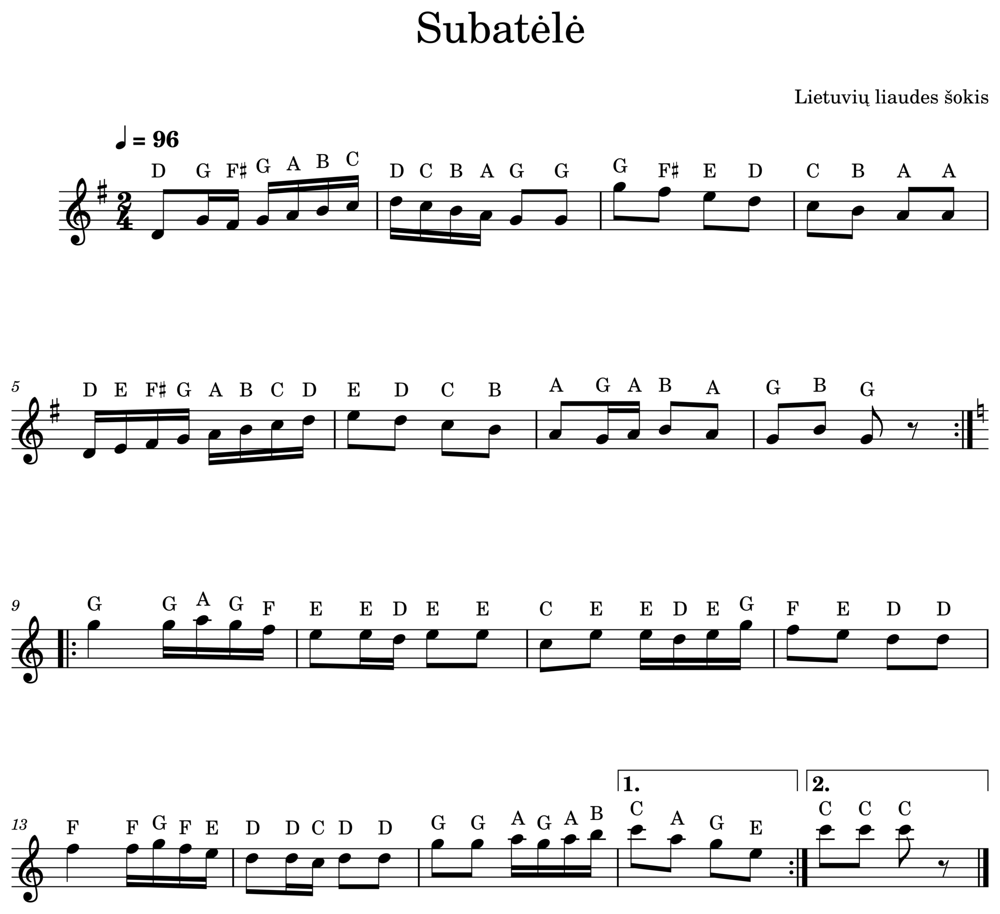

<a href="/assets/pdfs/Subatele-full-arrangement.pdf">Download the full arrangement (PDF)</a>

<h2>Videos</h2>

<iframe width="560" height="315" src="https://www.youtube.com/embed/xiJyTVjG3Bg?si=8aTJus6U7fBKdyBF" title="YouTube video player" frameborder="0" allow="accelerometer; autoplay; clipboard-write; encrypted-media; gyroscope; picture-in-picture; web-share" referrerpolicy="strict-origin-when-cross-origin" allowfullscreen></iframe>

<video controls preload="metadata" playsinline aria-label="Subatėlė performance video 2" style="max-width: 100%; height: auto;">
  <source src="/assets/videos/Subatele-performance-2.mp4" type="video/mp4">
  Your browser does not support HTML video.
</video>

<video controls preload="metadata" playsinline aria-label="Subatėlė performance video 1" style="max-width: 100%; height: auto;">
  <source src="/assets/videos/Subatele-performance-1.mp4" type="video/mp4">
  Your browser does not support HTML video.
</video>
